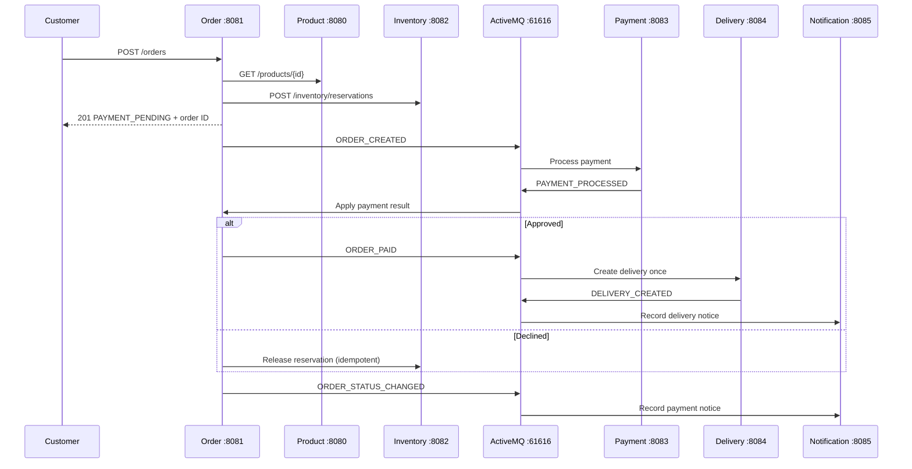

# Architecture

ShopLink is a Java 17 / Spring Boot 3.5 systems integration portfolio project.
Six services own independent in-memory state. ActiveMQ Classic buffers JSON
events between them. Payments and notifications are simulations.

Each arrow through the broker uses a separate queue. There are no JMS topics in
this implementation. The order result and delivery notice may arrive in either
order; clients poll the query APIs for eventual completion.

## State and ownership

| Service | State | Concurrency protection |
|---|---|---|
| Product | Fixed sample catalog | Immutable product records |
| Inventory | Stock, reservations, released IDs | One monitor around complete operations |
| Order | Orders, pending events, pending releases | Concurrent order map; synchronized transitions and retry buffers |
| Payment | Simulated payment per order | Synchronized create/find; conflicting duplicates rejected |
| Delivery | Delivery per order | Concurrent map with atomic compute-if-absent |
| Notification | Notice per order and type | Concurrent map with put-if-absent |

Prices and currency come from Product Service. Order Service calculates totals;
payment events must match both amount and currency before a state change.

## Order states

`PAYMENT_PENDING` becomes `PAID` for approval. Decline first stores
`STOCK_RELEASE_PENDING`; only a successful stock release allows `PAYMENT_FAILED`.
Repeated or conflicting terminal payment results cannot change a completed order.
Order creation returns the initial state even if asynchronous processing has
already advanced the stored order by the time the HTTP response arrives.

## Reliability boundary

JMS listeners use local transactions. Payment and Delivery return replies on the
listener session so consumption and reply commit together. Order publications use
a separate in-memory retry buffer and a scheduler, because removing a buffered
publication before a listener transaction commits would lose it on rollback.
At-least-once delivery can produce duplicates; consumer idempotency prevents
repeated business effects while the process remains running.

Application state and retry buffers are intentionally not durable. A process
restart can lose them while the broker retains messages. There is no shared
database, distributed transaction, authentication system, real payment provider,
email provider, or production deployment in this portfolio scope. See the
[operations runbook](operations.md) before restarting individual services.
